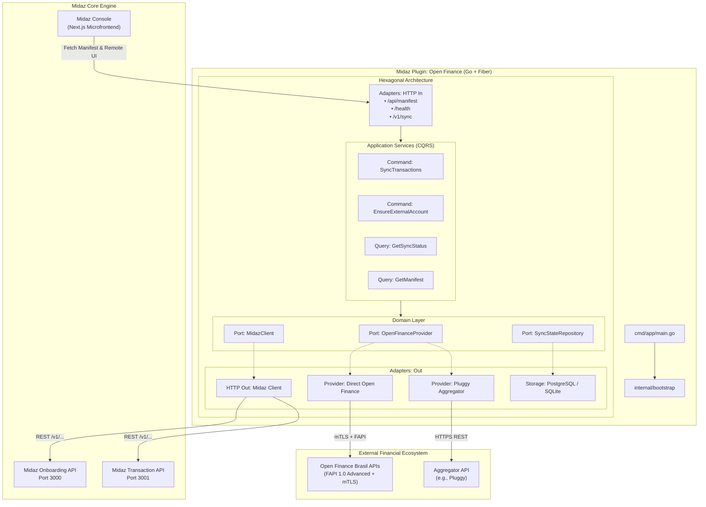
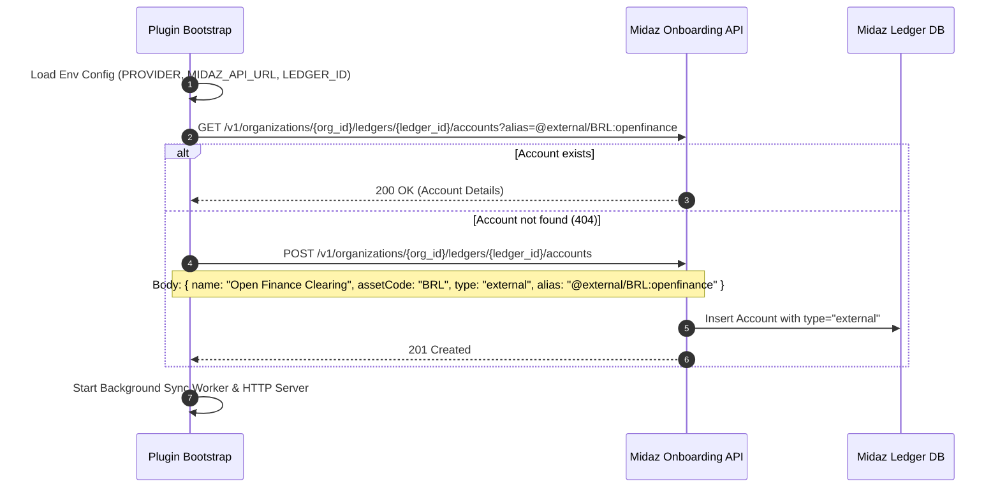
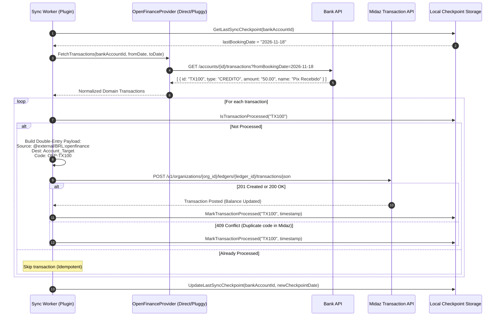

# Technical Architecture & Design: Midaz Open Finance Plugin

## 1. System Overview & Boundaries

The **Midaz Open Finance Plugin** is built as an independent microservice that strictly adheres to the architectural, coding, and operational standards established in the Midaz Core repository (`github.com/LerianStudio/midaz/v3`).



---

## 2. Clean Architecture & CQRS Implementation

To ensure seamless maintainability and code parity with Midaz core components (`components/onboarding` and `components/transaction`), the plugin adopts the Hexagonal and CQRS patterns:

### 2.1. Directory Structure

```
plugins/plugin-openfinance/
├── cmd/
│   └── app/
│       └── main.go                  # Service entrypoint, env initialization, lifecycle
├── internal/
│   ├── bootstrap/
│   │   ├── config.go                # Top-level configuration struct with env tags
│   │   └── service.go               # Dependency injection container & server runner
│   ├── domain/
│   │   ├── provider.go              # OpenFinanceProvider interface & transaction contracts
│   │   ├── account_mapping.go       # Bank account to Midaz account association
│   │   └── sync_state.go            # Checkpoint metadata & idempotency records
│   ├── services/
│   │   ├── command/
│   │   │   ├── sync_transactions.go # Orchestrates batch pulling and ledger posting
│   │   │   └── ensure_account.go    # Validates and creates @external/BRL account
│   │   └── query/
│   │       ├── get_manifest.go      # Provides Midaz Console manifest
│   │       └── get_sync_status.go   # Queries sync health and execution history
│   └── adapters/
│       ├── http/
│       │   └── in/
│       │       ├── router.go        # Fiber web router setup & middleware attachment
│       │       ├── manifest.go      # /api/manifest handler
│       │       ├── sync_handler.go  # Manual sync trigger handler
│       │       └── health.go        # Health check handler
│       ├── http/
│       │   └── out/
│       │       └── midaz/
│       │           └── client.go    # Midaz HTTP client (account lookup, transaction posting)
│       ├── providers/
│       │   ├── factory.go           # Instantiates provider based on cfg.Provider
│       │   ├── openfinance/
│       │   │   └── client.go        # Direct Open Finance Brasil (mTLS, JWS, FAPI)
│       │   └── pluggy/
│       │       └── client.go        # Pluggy aggregator client
│       └── storage/
│           └── postgres/            # Checkpoint and idempotency persistence
```

---

## 3. End-to-End Sequence Diagrams

### 3.1. Startup & Clearing Account Bootstrapping

Before processing any transaction, the plugin ensures that the ledger has the appropriate `@external` clearing account registered.



---

### 3.2. Transaction Sync and Idempotent Double-Entry Ingestion



---

## 4. Concurrency & Idempotency Guarantees

1. **Deterministic Unique Codes:**
   Every transaction pushed to Midaz has its `code` formatted as:
   `code = "OFP-" + providerTransactionId`
   Midaz enforces unique constraint indexing on `(ledger_id, code)`. If a concurrent worker or network retry triggers an identical post, Midaz rejects the second insert with a duplicate code error, preserving ledger integrity.

2. **Distributed Locking:**
   When running multiple replicas of the plugin, the `SyncWorker` acquires a Redis/PostgreSQL advisory lock per `bank_account_id` before starting an ingestion cycle to eliminate race conditions.

3. **Safe Lookback Window:**
   Bank statement APIs occasionally back-date or settle transactions after the fact. The sync worker always requests transactions starting from `lastBookingDate - 1 day` (a 24-hour lookback window), relying on the idempotency engine to discard previously ingested entries.
