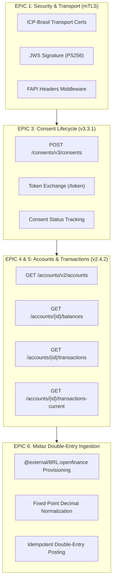

# Open Finance Brasil Implementation Plan: Epics, User Stories & Tasks

Based on the official specifications from [OpenBanking-Brasil/openapi](https://github.com/OpenBanking-Brasil/openapi):
* **Consents API:** `v3.3.1` ([specs/openfinance-brasil/consents-3.3.1.yml](../specs/openfinance-brasil/consents-3.3.1.yml))
* **Accounts API:** `v2.4.2` ([specs/openfinance-brasil/accounts-2.4.2.yml](../specs/openfinance-brasil/accounts-2.4.2.yml))
* **Resources API:** `v3.1.0` ([specs/openfinance-brasil/resources-3.1.0.yml](../specs/openfinance-brasil/resources-3.1.0.yml))

---

## Architecture Traceability Matrix



---

## EPIC 1: Cryptographic Infrastructure & Transport Security (FAPI 1.0 Advanced)
**Goal:** Establish secure, compliant, mutual-authenticated TLS connections and request signing required by the Central Bank of Brazil (BACEN) and Open Finance Brasil.

### Story 1.1: ICP-Brasil mTLS HTTP Client Engine
As an Open Finance integration engineer,  
I want a customized Go `http.Client` configured with ICP-Brasil X.509 client certificates and BACEN-approved TLS 1.2/1.3 cipher suites,  
So that our plugin can establish mTLS handshakes with banking authorization servers and resource servers.

- **Tasks:**
  - [ ] **1.1.1:** Implement certificate loading utility in `internal/adapters/providers/openfinance/crypto/tls.go` supporting PEM and PKCS#12 certificates.
  - [ ] **1.1.2:** Configure `tls.Config` with mandatory FAPI ciphers (`TLS_ECDHE_RSA_WITH_AES_128_GCM_SHA256`, `TLS_ECDHE_ECDSA_WITH_AES_128_GCM_SHA256`, etc.).
  - [ ] **1.1.3:** Implement automated certificate expiration health-check check with alerts when validity < 30 days.

### Story 1.2: JWS Payload Signature Provider
As a security subsystem,  
I want to sign outbound consent request payloads using a private key and `PS256` (or `ES256`) algorithms,  
So that the bank can verify request integrity and non-repudiation.

- **Tasks:**
  - [ ] **1.2.1:** Implement `JWSSigner` interface in `internal/adapters/providers/openfinance/crypto/jws.go` using `go-jose/v4`.
  - [ ] **1.2.2:** Format JWS protected headers: `alg: "PS256"`, `kid: "<key-id>"`, `typ: "JWT"`, `b64: false`.
  - [ ] **1.2.3:** Add unit tests validating signed JWTs against Open Finance test public keys.

### Story 1.3: Mandatory FAPI Header Injection Middleware
As an API client,  
I want all outbound Open Finance requests to include required FAPI tracing and auditing headers,  
So that transactions pass strict validation by bank API gateways.

- **Tasks:**
  - [ ] **1.3.1:** Create `FAPIHeaderInterceptor` injecting:
    - `x-fapi-interaction-id`: RFC 4122 UUID v4 (unique per request).
    - `x-fapi-auth-date`: RFC 7231 HTTP Date format (e.g. `Thu, 19 Nov 2026 03:50:00 GMT`).
    - `x-fapi-customer-ip-address`: IP address of client or proxy.
    - `x-customer-user-agent`: Standardized client User-Agent string.
  - [ ] **1.3.2:** Verify that the server response echoes `x-fapi-interaction-id` and log correlation IDs in Zap structured logger.

---

## EPIC 2: Participant Directory & OpenID Discovery
**Goal:** Automatically locate bank Authorization Server endpoints and validate trusted certificates.

### Story 2.1: Open Finance Directory Metadata Ingestion
As a system operator,  
I want the plugin to query the Open Finance Brasil Directory of Participants (Sandbox & Production),  
So that we dynamically discover Issuer URLs, `jwks_uri`, and Resource Server endpoints for each bank COMPE code.

- **Tasks:**
  - [ ] **2.1.1:** Implement Directory client in `internal/adapters/providers/openfinance/directory/client.go`.
  - [ ] **2.1.2:** Query `/.well-known/openid-configuration` per participant and cache discovery documents with TTL.
  - [ ] **2.1.3:** Map bank COMPE codes (e.g. `001` = BB, `341` = Itaú, `237` = Bradesco, `033` = Santander) to their respective Authorisation and Resource Servers.

---

## EPIC 3: Consent Management Engine (`consents v3.3.1`)
**Goal:** Manage customer consents according to the official `swagger-apis/consents/3.3.1.yml` specification.

### Story 3.1: Consent Initialization (`POST /consents/v3/consents`)
As a treasury officer,  
I want to initiate a consent request to read account balances and transactions,  
So that the bank generates a `consentId` awaiting authorization.

- **Tasks:**
  - [ ] **3.1.1:** Implement request payload generator in `internal/adapters/providers/openfinance/consent/create.go`:
    ```json
    {
      "data": {
        "permissions": [
          "ACCOUNTS_READ",
          "ACCOUNTS_BALANCES_READ",
          "ACCOUNTS_TRANSACTIONS_READ",
          "RESOURCES_READ"
        ],
        "expirationDateTime": "2027-11-19T00:00:00Z",
        "transactionFromDateTime": "2025-11-19T00:00:00Z",
        "transactionToDateTime": "2026-11-19T23:59:59Z"
      }
    }
    ```
  - [ ] **3.1.2:** Enforce validation rules from `consents-3.3.1.yml`:
    - `expirationDateTime`: RFC-3339 UTC pattern `^(\d{4})-(1[0-2]|0?[1-9])-(3[01]|[12][0-9]|0?[1-9])T(?:[01]\d|2[0123]):(?:[012345]\d):(?:[012345]\d)Z$`.
    - Maximum query window constraint: up to 12 months in the past.
  - [ ] **3.1.3:** Handle HTTP 201 response capturing `consentId` and initial status `AWAITING_AUTHORISATION`.

### Story 3.2: FAPI Hybrid Authorization & Token Exchange
As an Open Finance service,  
I want to exchange authorization codes for OAuth 2.0 access tokens using `private_key_jwt` authentication,  
So that we obtain tokens scoped for `consent:<consentId>` and `accounts`.

- **Tasks:**
  - [ ] **3.2.1:** Implement PKCE code verifier and code challenge generation (`S256`).
  - [ ] **3.2.2:** Build `/token` request with `grant_type=authorization_code`, client assertion signed with ICP-Brasil private key.
  - [ ] **3.2.3:** Persist encrypted `access_token` and `refresh_token` with automatic refresh logic 5 minutes prior to expiration.

### Story 3.3: Consent Status Polling & Lifecycle (`GET /consents/v3/consents/{consentId}`)
As a background worker,  
I want to verify consent status transitions,  
So that sync runs only execute against active (`AUTHORISED`) consents.

- **Tasks:**
  - [ ] **3.3.1:** Implement `GET /consents/v3/consents/{consentId}` polling.
  - [ ] **3.3.2:** Handle status transitions: `AUTHORISED`, `REJECTED`, `REVOKED`.
  - [ ] **3.3.3:** Halt syncing and trigger notification when consent reaches `REVOKED` or expired state.

---

## EPIC 4: Account Discovery & Real-Time Balances (`accounts v2.4.2`)
**Goal:** Query consented bank accounts and real-time balances per `swagger-apis/accounts/2.4.2.yml`.

### Story 4.1: List Consented Accounts (`GET /accounts/v2/accounts`)
As an account mapper,  
I want to list all accounts bound to the authorized consent,  
So that the plugin can establish associations with corresponding Midaz accounts.

- **Tasks:**
  - [ ] **4.1.1:** Implement HTTP client for `GET /open-banking/accounts/v2/accounts`.
  - [ ] **4.1.2:** Parse response schema `ResponseAccountList`:
    - `accountId`: Unique UUID/hash.
    - `brandName`: Financial institution display brand.
    - `companyCnpj`: Bank CNPJ (14 digits).
    - `type`: `CONTA_DEPOSITO_A_VISTA`, `CONTA_POUPANCA`, `CONTA_PAGAMENTO_PRE_PAGA`.
    - `compeCode`: 3 digits (e.g. `"341"`).
    - `branchCode`: 4 digits agency code.
    - `number`: Account number.
    - `checkDigit`: Account check digit.
  - [ ] **4.1.3:** Handle pagination metadata (`links`, `meta.totalPages`, `meta.totalRecords`).

### Story 4.2: Real-Time Balance Ingestion (`GET /accounts/v2/accounts/{accountId}/balances`)
As a treasury manager,  
I want to retrieve current and available account balances,  
So that the plugin can cross-check bank balances against the Midaz ledger balance.

- **Tasks:**
  - [ ] **4.2.1:** Implement `GET /open-banking/accounts/v2/accounts/{accountId}/balances`.
  - [ ] **4.2.2:** Extract `availableAmount`, `blockedAmount`, and `automaticallyInvestedAmount`.
  - [ ] **4.2.3:** Calculate ledger variance: $\Delta = \text{MidazAccountBalance} - \text{BankAvailableAmount}$.

---

## EPIC 5: Transaction Statement Ingestion Engine (`accounts v2.4.2`)
**Goal:** Ingest historical and real-time bank statement lines according to the Open Finance Brasil standard.

### Story 5.1: Historical Transaction Statement Sync (`GET /accounts/v2/accounts/{accountId}/transactions`)
As a synchronization worker,  
I want to pull transactions within a parameterized date range with full pagination support,  
So that all historical movements are imported without omission.

- **Tasks:**
  - [ ] **5.1.1:** Implement `GET /open-banking/accounts/v2/accounts/{accountId}/transactions` supporting query parameters:
    - `fromBookingDate`: `YYYY-MM-DD` (max 12 months prior).
    - `toBookingDate`: `YYYY-MM-DD`.
    - `page`: Integer (1-based).
    - `pageSize`: Integer (e.g. 500 or 1000).
    - `pagination-key`: String cursor.
  - [ ] **5.1.2:** Parse `AccountTransactionsData` schema:
    - `transactionId`: `^[a-zA-Z0-9][a-zA-Z0-9-]{0,99}$` (Unique immutable transaction ID).
    - `completedAuthorisedPaymentType`: Enum (`PIX`, `TED`, `DOC`, `TEF`, `BOLETO`, etc.).
    - `creditDebitType`: `CREDITO` | `DEBITO`.
    - `transactionName`: Human-readable statement string (max 200 chars).
    - `type`: Enum `EnumTransactionTypes`.
    - `transactionAmount.amount`: Decimal string with 2-4 decimal places (`^\d{1,15}\.\d{2,4}$`).
    - `transactionAmount.currency`: `BRL` (ISO 4217).
    - `transactionDateTime`: ISO-8601 UTC with milliseconds.
    - Counterparty details: `partieCnpjCpf`, `partiePersonType`, `partieCompeCode`, `partieBranchCode`, `partieNumber`, `partieCheckDigit`.
  - [ ] **5.1.3:** Handle pagination loop through `links.next` until `currentPage == totalPages`.

### Story 5.2: Intraday / Current Transactions Sync (`GET /accounts/v2/accounts/{accountId}/transactions-current`)
As a real-time reconciliation engine,  
I want to poll current-day transactions using the dedicated current transactions endpoint,  
So that recent intraday movements (such as Pix received minutes ago) are mirrored rapidly without querying 12-month historical volumes.

- **Tasks:**
  - [ ] **5.2.1:** Implement `GET /open-banking/accounts/v2/accounts/{accountId}/transactions-current`.
  - [ ] **5.2.2:** Execute on high frequency (e.g. every 5 to 15 minutes) during business hours.

### Story 5.3: Throttling & Rate-Limit Backoff (HTTP 429)
As a resilient HTTP client,  
I want automatic exponential backoff with jitter when encountering HTTP 429 or 529 responses,  
So that we adhere to bank rate limits without dropping synchronization batches.

- **Tasks:**
  - [ ] **5.3.1:** Inspect `Retry-After` header when HTTP 429 is received.
  - [ ] **5.3.2:** Apply exponential backoff with full jitter: $t_{\text{sleep}} = \min(60, 2^{\text{attempt}}) + \text{rand}(0, 1)$.
  - [ ] **5.3.3:** Circuit breaker pattern tripping after 5 consecutive failures.

---

## EPIC 6: Midaz Ledger Ingestion Engine (Double-Entry & `@external`)
**Goal:** Transform Open Finance statements into mathematically balanced, immutable Midaz double-entry transactions.

### Story 6.1: Automated Clearing Account Verification (`@external/BRL:openfinance`)
As the ledger bridge,  
I want to guarantee that the clearing account `@external/BRL:openfinance` is provisioned with `type="external"`,  
So that it can legally hold negative balances representing external liquidity.

- **Tasks:**
  - [ ] **6.1.1:** Query Midaz Onboarding API `GET /v1/organizations/{org}/ledgers/{ledger}/accounts?alias=@external/BRL:openfinance`.
  - [ ] **6.1.2:** If absent, invoke `POST /v1/organizations/{org}/ledgers/{ledger}/accounts` with payload:
    ```json
    {
      "name": "Open Finance External Clearing",
      "assetCode": "BRL",
      "type": "external",
      "alias": "@external/BRL:openfinance"
    }
    ```
  - [ ] **6.1.3:** Block startup if Midaz rejects clearing account creation.

### Story 6.2: Normalized Transaction Mapping & Scale Conversion
As an accounting mapper,  
I want to convert Open Finance bank statement amounts to integer values with scale 2,  
So that calculations avoid floating-point rounding errors.

- **Tasks:**
  - [ ] **6.2.1:** Parse `transactionAmount.amount` string using `shopspring/decimal`.
  - [ ] **6.2.2:** Calculate `integerValue = amount * 100` (e.g., `"1250.50"` $\implies$ `125050`, `scale: 2`).
  - [ ] **6.2.3:** Map transaction direction:
    - **`creditDebitType == "CREDITO"` (Bank Inflow):**
      - `source.from`: `[ { accountAlias: "@external/BRL:openfinance", amount: { asset: "BRL", value: "..." } } ]`
      - `distribute.to`: `[ { accountAlias: "<mapped_midaz_account>", amount: { asset: "BRL", value: "..." } } ]`
    - **`creditDebitType == "DEBITO"` (Bank Outflow):**
      - `source.from`: `[ { accountAlias: "<mapped_midaz_account>", amount: { asset: "BRL", value: "..." } } ]`
      - `distribute.to`: `[ { accountAlias: "@external/BRL:openfinance", amount: { asset: "BRL", value: "..." } } ]`

### Story 6.3: Idempotent Ledger Posting
As a ledger writer,  
I want each transaction to be identified uniquely by `code: "OFP-" + transactionId`,  
So that re-running synchronization never causes duplicate financial postings in Midaz.

- **Tasks:**
  - [ ] **6.3.1:** Construct Midaz Transaction payload with `code: "OFP-" + tx.TransactionID`.
  - [ ] **6.3.2:** Populate `metadata` with counterparty CPF/CNPJ, payment type, bank compe, and raw datetime.
  - [ ] **6.3.3:** Dispatch to `POST /v1/organizations/{org}/ledgers/{ledger}/transactions/json`.
  - [ ] **6.3.4:** If Midaz responds with `409 Conflict`, mark transaction as already recorded and proceed gracefully.

---

## EPIC 7: Multi-Provider Abstraction & Aggregator Fallback (Pluggy)
**Goal:** Enable seamless switching between Direct Open Finance and Aggregators via environment variables.

### Story 7.1: Provider Factory & Interface Adherence
As a developer,  
I want the sync engine to depend solely on `domain.OpenFinanceProvider`,  
So that swapping from `PROVIDER=openfinance` to `PROVIDER=pluggy` requires zero code modifications.

- **Tasks:**
  - [ ] **7.1.1:** Define `OpenFinanceProvider` interface with `ListAccounts`, `FetchTransactions`, and `HealthCheck`.
  - [ ] **7.1.2:** Implement `providers.NewProviderFactory(cfg)` instantiating the chosen adapter.
  - [ ] **7.1.3:** Provide pluggable mock provider for local unit and integration testing without live bank credentials.

### Story 7.2: Pluggy Provider Adapter Implementation
As an alternative to direct connection,  
I want an adapter connecting to Pluggy's REST API,  
So that teams without ICP-Brasil certificates can run the plugin immediately in sandbox and production.

- **Tasks:**
  - [ ] **7.2.1:** Implement Pluggy authentication (`POST /auth` using `clientId` + `clientSecret`).
  - [ ] **7.2.2:** Map Pluggy `/accounts` and `/transactions` responses to `domain.BankTransaction`.
  - [ ] **7.2.3:** Map Pluggy category and payment data into Midaz transaction metadata.

---

## EPIC 8: Operational API, Manifest & Midaz Console Integration
**Goal:** Deliver complete observability, health checks, manual triggers, and Midaz Console integration.

### Story 8.1: Midaz Console Manifest Discovery (`GET /api/manifest`)
As the Midaz Console frontend,  
I want to query `GET /api/manifest` on the plugin service,  
So that the plugin dynamically mounts in the console navigation without redeployment.

- **Tasks:**
  - [ ] **8.1.1:** Expose `GET /api/manifest` returning `PluginManifestEntity`:
    ```json
    {
      "name": "plugin-openfinance",
      "title": "Open Finance Sync",
      "description": "Automated bank statement mirroring and double-entry ledger reconciliation",
      "version": "1.0.0",
      "route": "/openfinance",
      "entry": "http://localhost:8085/remoteEntry.js",
      "healthcheck": "/health",
      "host": "http://localhost:8085",
      "icon": "Landmark",
      "enabled": true,
      "author": "Midaz Community"
    }
    ```
  - [ ] **8.1.2:** Support healthcheck endpoint `GET /health` verifying Midaz and Provider connectivity.

### Story 8.2: On-Demand Manual Synchronization API (`POST /v1/sync`)
As a financial operations user,  
I want to trigger an immediate sync for a specific account or date range,  
So that I don't have to wait for the scheduled hourly cron run.

- **Tasks:**
  - [x] **8.2.1:** Expose `POST /v1/sync` accepting `{ "bank_account_id": "...", "from_date": "...", "to_date": "..." }`.
  - [x] **8.2.2:** Return `202 Accepted` with a `job_id`.
  - [x] **8.2.3:** Provide `GET /v1/sync/status` returning execution history and metrics.

---

## Epic 9 [OFP-EPIC-05]: Pluggy Aggregator Integration & Real-Time Sync

### Story 9.1 [OFP-STORY-501]: Modernize Pluggy Client to API v2 & Connect Token
As an administrator without direct BACEN certificates,  
I want to connect to bank accounts using Pluggy,  
So that transaction statements can be mirrored into Midaz without regulatory delays.

- **Tasks:**
  - [x] **9.1.1:** Implement `POST /auth` exchange with 2-hour API Key cache.
  - [ ] **9.1.2:** Implement `CreateConnectToken(ctx, options)` for frontend Connect Widget onboarding.
  - [ ] **9.1.3:** Upgrade `FetchTransactions` to cursor-based `GET /v2/transactions` (`after` cursor & `createdAtFrom`).
  - [ ] **9.1.4:** Implement `GetItem(ctx, itemID)` to query connection status (`UPDATED`, `LOGIN_ERROR`, `WAITING_USER_INPUT`).
  - [ ] **9.1.5:** Implement active `HealthCheck(ctx)` checking upstream connectivity.
  - [ ] **9.1.6:** Add unit tests with mock HTTP server covering all v2 endpoints.

### Story 9.2 [OFP-STORY-502]: Real-Time Event-Driven Webhooks (`POST /webhooks/pluggy`)
As a ledger system,  
I want to receive real-time notifications from Pluggy when new transactions are available,  
So that Midaz balances are updated immediately without waiting for hourly cron ticks.

- **Tasks:**
  - [ ] **9.2.1:** Define webhook models (`PluggyWebhookEvent`, `TransactionCreatedPayload`).
  - [ ] **9.2.2:** Implement `WebhookHandler` in `internal/adapters/http/in/webhook_handler.go`.
  - [ ] **9.2.3:** Add security validation: verify `payload.clientId == cfg.PluggyClientID` and optional webhook secret.
  - [ ] **9.2.4:** On `transactions/created`, page `createdTransactionsLink` and post balanced entries to Midaz.
  - [ ] **9.2.5:** On `item/error` or `item/deleted`, update `bank_connections` status in PostgreSQL.
  - [ ] **9.2.6:** Register route `POST /webhooks/pluggy` in Fiber router.
  - [ ] **9.2.7:** Add unit tests for webhook parsing, error handling, and deduplication.

### Story 9.3 [OFP-STORY-503]: Pluggy Connection Onboarding & Account Mapping API
As an application frontend,  
I want an API to register a newly connected Pluggy Item and map its accounts to Midaz aliases,  
So that subsequent sync cycles know which Midaz account to balance.

- **Tasks:**
  - [ ] **9.3.1:** Create `CreatePluggyConnectionUseCase` in command services.
  - [ ] **9.3.2:** Expose endpoint `POST /v1/connections/pluggy` receiving `{ "item_id": "...", "account_id": "...", "midaz_alias": "..." }`.
  - [ ] **9.3.3:** Persist in PostgreSQL `bank_connections` table with `provider='pluggy'`.
  - [ ] **9.3.4:** Add unit tests for connection registration and validation.

