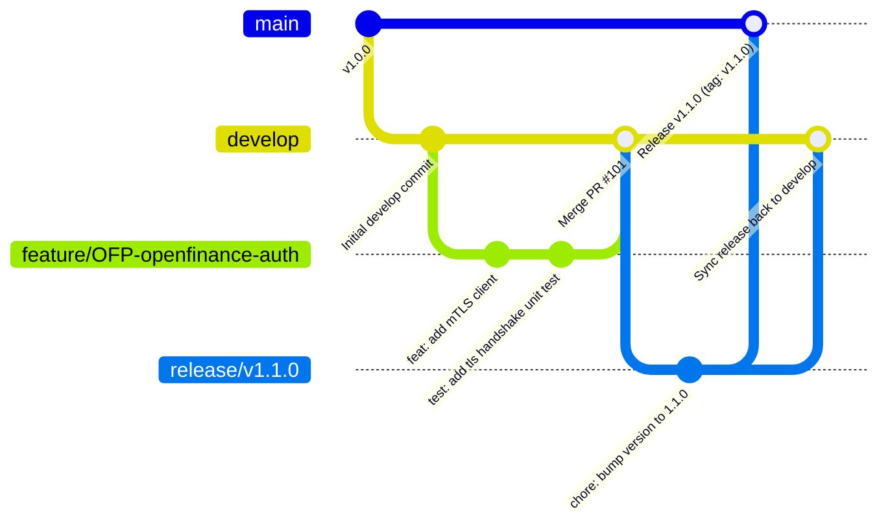

# Git Rules, Branching Model & Commit Conventions

To maintain strict parity with the Midaz Core project (`github.com/LerianStudio/midaz/v3`), all contributors, engineers, and automated agents working on the Open Finance Plugin must adhere to the following Git workflow and versioning standards.

---

## 1. Branching Strategy (GitFlow Variant)

Midaz utilizes a disciplined branching model enforced via GitHub Actions (see [.github/workflows/check-branch.yml](file:///Users/adryanalencar/Documents/projetos%202/midaz/.github/workflows/check-branch.yml)):



### 1.1. Permanent Branches
* **`main`:** Production-ready state. Only receives merges from `develop`, `release-candidate`, or `hotfix/*`. Direct pushes and feature PRs targeted directly to `main` are **strictly blocked by CI**.
* **`develop`:** Primary integration branch. All feature branches, bug fixes, and improvements must target `develop`.

### 1.2. Temporary Branches & Naming Convention

| Branch Type | Prefix & Pattern | Base Branch | Target PR Branch | Example |
| :--- | :--- | :--- | :--- | :--- |
| **Feature** | `feature/OFP-<id>-<description>` | `develop` | `develop` | `feature/OFP-101-openfinance-mtls` |
| **Bug Fix** | `fix/OFP-<id>-<description>` | `develop` | `develop` | `fix/OFP-105-account-pagination` |
| **Hotfix** | `hotfix/OFP-<version>` | `main` | `main` & `develop` | `hotfix/OFP-v1.0.1` |
| **Chore / Task** | `chore/<description>` | `develop` | `develop` | `chore/update-openapi-specs` |
| **Docs** | `docs/<description>` | `develop` | `develop` | `docs/add-git-conventions` |
| **Release** | `release/v<version>` | `develop` | `main` | `release/v1.0.0` |

---

## 2. Conventional Commits Standard

All commit messages must strictly conform to the **Conventional Commits v1.0.0** specification. Automated semantic release pipelines and changelog generators rely on this format.

### 2.1. Structure
```
<type>(<optional scope>): <subject in lowercase imperative mood>

[optional body explaining WHY the change was made]

[optional footer(s) referencing Jira/GitHub issues]
```

### 2.2. Allowed Commit Types

| Type | Purpose | Example |
| :--- | :--- | :--- |
| **`feat`** | A new user-facing or architectural capability | `feat(openfinance): implement mTLS transport for banking requests` |
| **`fix`** | A bug fix in existing behavior | `fix(midaz): handle duplicate transaction 409 conflict gracefully` |
| **`test`** | Adding missing unit/integration tests or refactoring tests | `test(midaz): add table-driven test for decimal scale conversion` |
| **`docs`** | Documentation-only updates | `docs(git): add branch naming and PR checklist rules` |
| **`chore`** | Maintenance, dependencies, build configurations | `chore(deps): update lib-commons to v2.5.3` |
| **`refactor`** | Code change that neither fixes a bug nor adds a feature | `refactor(provider): extract interface to domain layer` |
| **`perf`** | Code change improving performance | `perf(sync): cache active bank consent tokens in redis` |
| **`style`** | Formatting, whitespace, missing semi-colons (no logic change) | `style(router): align middleware declarations` |

### 2.3. Golden Rules for Commit Messages
1. **Imperative Mood:** Use `add`, not `added` or `adds`; use `fix`, not `fixing` or `fixed`.
2. **No Trailing Period:** Do not end the subject line with a `.`.
3. **Lowercase Subject:** Start the subject with a lowercase letter.
4. **Atomic Commits:** Each commit must represent a single logical change that compiles and passes tests.

---

## 3. Pull Request Guidelines & Checklist

Every Pull Request must follow the [Midaz PR Template](file:///Users/adryanalencar/Documents/projetos%202/midaz/.github/pull_request_template.md).

### 3.1. PR Title Format
PR titles must mirror the primary Conventional Commit:
* ✅ `feat(openfinance): add consent client implementation`
* ✅ `fix(sync): resolve offset calculation for historical transactions`
* ❌ `Added new features` *(Rejected by CI)*

### 3.2. Mandatory PR Checklist
Before submitting a PR for review, authors must verify:
- [ ] Base branch is set to **`develop`** (never `main` for standard changes).
- [ ] Unit tests are written and pass (`go test -race ./...`).
- [ ] Code has zero lint warnings (`golangci-lint run`).
- [ ] Documentation has been updated to reflect any API or behavioral changes.
- [ ] Commit history is clean, properly structured, and rebased on latest `develop`.
- [ ] Cryptographic secrets, certificates, or sensitive tokens are not committed to git.
