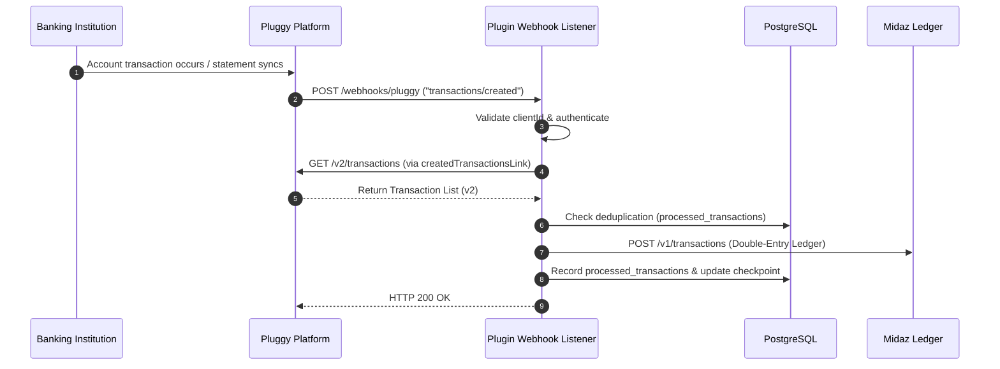

# Specification & Architecture: Pluggy Open Finance Provider

## 1. Executive Summary

The **Pluggy Provider** enables the Midaz Open Finance Plugin to ingest bank statements and transaction feeds from over 30+ Brazilian financial institutions, fintechs, and credit card issuers via the Pluggy Aggregator API.

While the Direct Open Finance Brasil provider requires regulatory participant status, mTLS ICP-Brasil digital certificates, and FAPI conformance, the Pluggy provider allows instant setup using standard API keys (`CLIENT_ID` + `CLIENT_SECRET`).

This document outlines the end-to-end technical specifications, API contracts, accounting rules, webhook lifecycle, and implementation plan for the Pluggy integration based on official Pluggy API specifications (OpenAPI 3.1.0).

---

## 2. Technical Reference & Endpoints

Based on `specs/pluggy/pluggy-api.json` and official developer documentation:

### 2.1. Authentication (`POST /auth`)
- **Endpoint**: `POST https://api.pluggy.ai/auth`
- **Request Body**:
  ```json
  {
    "clientId": "your-client-id",
    "clientSecret": "your-client-secret"
  }
  ```
- **Response**:
  ```json
  {
    "apiKey": "jwt-token-string"
  }
  ```
- **Lifecycle**: The `apiKey` is valid for **2 hours**. Requests must pass the header: `X-API-KEY: <apiKey>`. The plugin caches this token in memory with automatic refresh.

### 2.2. Connect Token (`POST /connect_token`)
- **Endpoint**: `POST https://api.pluggy.ai/connect_token`
- **Purpose**: Generates a temporary `accessToken` to initialize the Pluggy Connect Widget on the client-side, allowing users to authenticate with their bank securely.
- **Request Body**:
  ```json
  {
    "itemId": "optional-uuid-for-updating-existing-item",
    "options": {
      "webhookUrl": "https://plugin.midaz.internal/webhooks/pluggy",
      "clientUserId": "midaz-org-id",
      "avoidDuplicates": true
    }
  }
  ```
- **Response**:
  ```json
  {
    "accessToken": "eyJhbGciOiJSUzI1NiIsInR5cCI6..."
  }
  ```

### 2.3. Items API (`GET /items/{id}` & `DELETE /items/{id}`)
An **Item** represents an established connection between a user and a financial institution.
- **Statuses**:
  - `UPDATED`: Synchronization complete; accounts and transactions are ready.
  - `UPDATING`: The connector is actively scraping/syncing with the bank.
  - `WAITING_USER_INPUT`: Additional MFA, SMS code, or token is required.
  - `LOGIN_ERROR`: Bank credentials expired or invalid; requires widget reconnect.
  - `OUTDATED`: Item has not been synchronized recently.

### 2.4. Accounts API (`GET /accounts?itemId={id}`)
Lists all accounts associated with an Item (Checking, Savings, Credit Card, Investment).
- Returns: `id`, `name`, `number`, `agency`, `type`, `currencyCode`, `connector.name`.

### 2.5. Transactions API v2 (`GET /v2/transactions`)
> [!IMPORTANT]
> The v1 `/transactions` endpoint is deprecated. The plugin exclusively uses the modern `/v2/transactions` cursor-paginated API.

- **Query Parameters**:
  - `accountId`: Account UUID (required).
  - `dateFrom` & `dateTo`: Filter by transaction booking date (`YYYY-MM-DD`).
  - `createdAtFrom`: Filter by synchronization timestamp (`ISO 8601`).
  - `after`: Opaque pagination cursor.
- **Response Format (`CursorPageResponseTransactions`)**:
  ```json
  {
    "results": [
      {
        "id": "a8534c85-53ce-4f21-94d7-50e9d2ee4957",
        "description": "PIX RECEBIDO - EMPRESA XYZ",
        "amount": 250.00,
        "date": "2026-11-19T00:00:00.000Z",
        "currencyCode": "BRL",
        "type": "CREDIT",
        "status": "POSTED",
        "paymentData": {
          "paymentMethod": "PIX"
        }
      }
    ],
    "next": "?accountId=...&after=MjAyNS0wMi0xM1QxOD..."
  }
  ```
- **Pagination Rule**: When `next` is not null, fetch `GET /v2/transactions{next}` until `next == null`.

---

## 3. Real-Time Webhook Architecture

In addition to scheduled background polling, Pluggy supports event-driven real-time webhooks:



### 3.1. Supported Webhook Events
1. **`transactions/created`**:
   - Carries `createdTransactionsLink` pointing directly to `/v2/transactions?accountId=...&createdAtFrom=...`.
   - The plugin pages the link immediately and creates balanced ledger entries.
2. **`item/updated`**:
   - Updates `bank_connections.status = 'ACTIVE'` and refreshes metadata.
3. **`item/error`**:
   - Updates `bank_connections.status = 'LOGIN_ERROR'` or `'REVOKED'`.
4. **`item/waiting_user_input`**:
   - Updates `bank_connections.status = 'MFA_REQUIRED'`.
5. **`item/deleted`**:
   - Updates `bank_connections.status = 'DISCONNECTED'`.

### 3.2. Webhook Security
- **Client ID Validation**: Ensure `payload.clientId == cfg.PluggyClientID`.
- **Secret Token Validation**: If configured, validate `X-Webhook-Secret` header.

---

## 4. Midaz Double-Entry Ledger Mapping

Every transaction ingested from Pluggy follows the exact Midaz double-entry accounting invariant:

| Pluggy Type / Amount | Transaction Flow | Midaz Double-Entry Operations |
| :--- | :--- | :--- |
| **CREDIT** (Inflow, e.g., Pix received, deposit) | Money enters the user's account | 1. **Debit**: `@external/BRL:openfinance` (external clearing)<br>2. **Credit**: Target Midaz Account (`bank_connections.midaz_account_alias`) |
| **DEBIT** (Outflow, e.g., Pix sent, bill payment) | Money leaves the user's account | 1. **Debit**: Target Midaz Account (`bank_connections.midaz_account_alias`)<br>2. **Credit**: `@external/BRL:openfinance` (external clearing) |

- **Transaction Code**: `OFP-PLG-<transaction.id>` (guarantees idempotency in Midaz Core).
- **Deduplication**: `processed_transactions (bank_transaction_id = transaction.id)`.

---

## 5. Implementation Epics, Stories, and Tasks

### Epic OFP-EPIC-05: Pluggy Provider Integration & Real-Time Sync

#### Story OFP-STORY-501: Modernization of Pluggy Client to API v2 & Connect Token
* **Description**: Upgrade the existing Pluggy adapter to use the official v2 cursor-paginated transactions API, add Connect Token creation, and implement Item status checks.
* **Tasks**:
  * [x] **501.1**: Implement `POST /auth` with 2-hour token caching (already functional).
  * [ ] **501.2**: Implement `CreateConnectToken(ctx, options)` to generate widget launch tokens.
  * [ ] **501.3**: Upgrade `FetchTransactions` to `GET /v2/transactions` with cursor traversal (`next`).
  * [ ] **501.4**: Implement `GetItem(ctx, itemID)` to query connection status and error codes.
  * [ ] **501.5**: Implement active `HealthCheck(ctx)` checking upstream connectivity.
  * [ ] **501.6**: Author comprehensive unit tests with `httptest.Server`.

#### Story OFP-STORY-502: Real-Time Webhook Ingestion Engine
* **Description**: Expose an HTTP webhook endpoint in the Fiber router to receive events from Pluggy and trigger immediate incremental sync.
* **Tasks**:
  * [ ] **502.1**: Define webhook payload data models (`PluggyWebhookEvent`, `TransactionEventPayload`, `ItemEventPayload`).
  * [ ] **502.2**: Implement `WebhookHandler` in `internal/adapters/http/in/webhook_handler.go`.
  * [ ] **502.3**: Implement event router (`transactions/created`, `item/updated`, `item/error`, `item/deleted`).
  * [ ] **502.4**: Connect `transactions/created` directly to `createdTransactionsLink` ingestion pipeline.
  * [ ] **502.5**: Register route `POST /webhooks/pluggy` in `router.go`.
  * [ ] **502.6**: Unit tests covering valid payloads, mismatched client IDs, and concurrent webhook deliveries.

#### Story OFP-STORY-503: Connection Registration & Lifecycle Management
* **Description**: Allow linking a Pluggy Item and Account to a Midaz Account Alias in the database.
* **Tasks**:
  * [ ] **503.1**: Create `CreatePluggyConnectionUseCase` to persist new connection in `bank_connections`.
  * [ ] **503.2**: Register HTTP handler `POST /connections/pluggy` to register an item from the frontend Connect widget.
  * [ ] **503.3**: Ensure background worker seamlessly processes both `openfinance` and `pluggy` active connections.
  * [ ] **503.4**: Unit and integration tests.
